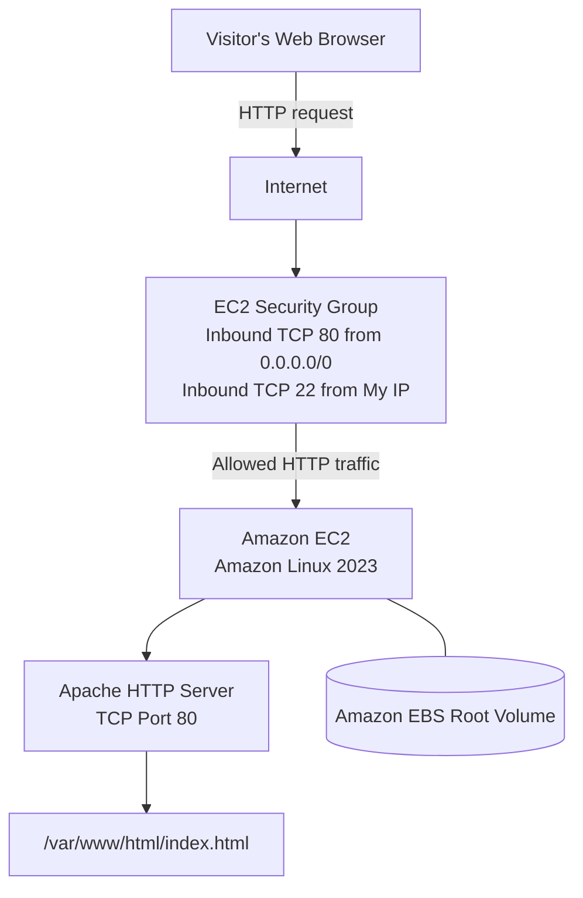
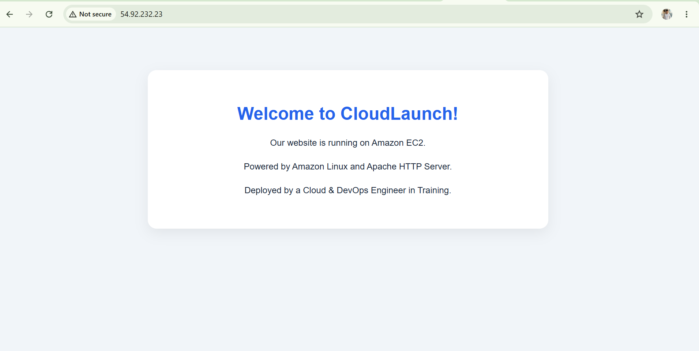
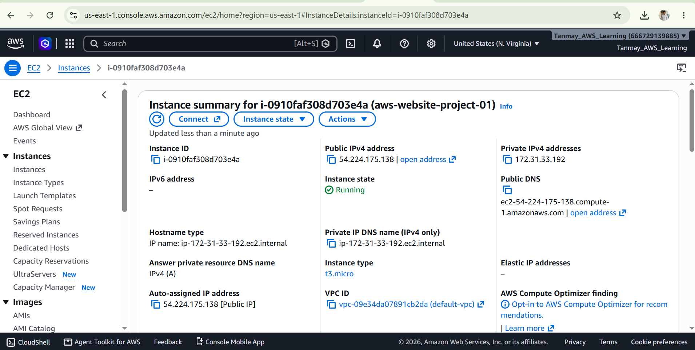
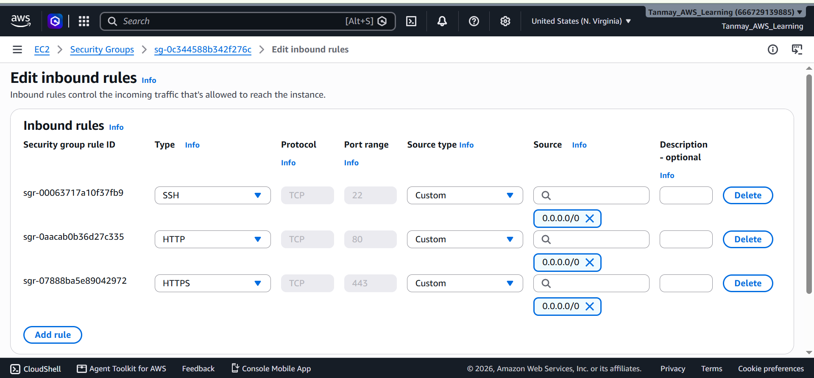

# AWS EC2 Website Hosting on Amazon Linux 2023


A beginner-friendly, end-to-end project that deploys a static business website on an Amazon EC2 Linux instance using Apache HTTP Server. It covers instance provisioning, SSH access, security groups, Linux permissions, HTTP verification, troubleshooting, and cleanup.

> **Project scenario:** A small business needs its first public website. As the cloud engineer, you provision a Linux server, configure access securely, deploy the page, verify it, and document how to diagnose common failures.

---

## Table of contents

- [Architecture](#architecture)
- [What you will build](#what-you-will-build)
- [Prerequisites](#prerequisites)
- [Repository structure](#repository-structure)
- [Step 1: Launch EC2](#step-1-launch-ec2)
- [Step 2: Configure the security group](#step-2-configure-the-security-group)
- [Step 3: Connect over SSH](#step-3-connect-over-ssh)
- [Step 4: Install and start Apache](#step-4-install-and-start-apache)
- [Step 5: Deploy the website](#step-5-deploy-the-website)
- [Step 6: Verify the deployment](#step-6-verify-the-deployment)
- [Troubleshooting guide](#troubleshooting-guide)
- [Security recommendations](#security-recommendations)
- [Cleanup to avoid ongoing charges](#cleanup-to-avoid-ongoing-charges)
- [Interview questions](#interview-questions)
- [Learning outcomes](#learning-outcomes)

## Architecture



### Request flow

1. A visitor opens `http://<EC2-PUBLIC-IP>` in a browser.
2. The request reaches the instance over the internet.
3. The EC2 security group allows TCP port `80`.
4. Apache listens on port `80` and reads `/var/www/html/index.html`.
5. Apache returns the HTML response to the visitor.
6. SSH on port `22` is used by the administrator and should be limited to a trusted IP address.

> **Important:** This is a learning project, not a hardened production architecture. HTTP is unencrypted. For production, use a domain, HTTPS/TLS, monitoring, patching, and an appropriate access design.

## What you will build

- One EC2 instance running Amazon Linux 2023
- Apache HTTP Server (`httpd`)
- One static HTML page
- An EBS root volume
- A security group allowing HTTP from the internet and SSH from your IP
- A documented troubleshooting and recovery workflow

## Prerequisites

- An active AWS account with billing checked.
- An AWS Region selected; this walkthrough uses **Asia Pacific (Mumbai), `ap-south-1`**. You can use another region, but create and manage the resources consistently in that region.
- A web browser and, for local SSH, Windows PowerShell or a terminal with an SSH client.
- Basic familiarity with EC2, Linux commands, and key pairs.

### Cost reminder

EC2 instances, EBS storage, public IPv4 addresses, and other resources may incur charges depending on your account and current AWS pricing/Free Tier eligibility. Check the current price shown in the console. Stop/terminate resources and check for leftover billable resources when finished.

## Repository structure

```text
aws-ec2-website-hosting/
├── README.md
├── index.html
├── troubleshooting.md
└── screenshots/
    ├── website.png
    ├── ec2-instance.png
    └── security-group.png
```

The screenshot files are placeholders for screenshots you capture from your own AWS account. Add them only after taking the screenshots; do not commit credentials, private keys, or account-sensitive information.

## Step 1: Launch EC2

1. Open the [AWS EC2 Console in Mumbai](https://ap-south-1.console.aws.amazon.com/ec2/home?region=ap-south-1).
2. Click **Launch instance**.
3. Configure the following:
   - **Name:** `aws-website-project-01`
   - **AMI:** Amazon Linux 2023 (official AWS image)
   - **Instance type:** choose a small eligible type, such as `t3.micro` if available; review pricing before launch
   - **Key pair:** create a new key pair named `aws-website-key`, choose PEM format, and download it securely
   - **Storage:** keep the default root EBS volume unless you have a reason to change it
4. Under network settings, create or select a security group as described in Step 2.
5. Review the configuration and click **Launch instance**.
6. Wait for the instance state to show **Running** and status checks to show **2/2 checks passed**.
7. Copy the **Public IPv4 address**. You will use it later.

Keep your `.pem` file private. AWS generally does not let you download the same private key again. Do not upload it to GitHub or share it in chat.

## Step 2: Configure the security group

Configure these **inbound** rules:

| Type | Protocol | Port | Source | Purpose |
|---|---|---:|---|---|
| SSH | TCP | 22 | My IP (`x.x.x.x/32`) | Administrative SSH access |
| HTTP | TCP | 80 | `0.0.0.0/0` | Public website access |

- Use **My IP** for SSH rather than allowing `0.0.0.0/0`.
- HTTP is public by design for this demo website.
- Security groups are stateful, so response traffic for allowed connections is automatically permitted.
- Keep the default outbound rules for this beginner project unless you have a specific network design.

## Step 3: Connect over SSH

### Option A: EC2 Instance Connect in the browser

1. In **EC2 → Instances**, select your instance.
2. Click **Connect**.
3. If EC2 Instance Connect is available and configured, select it and click **Connect**.
4. Continue to Step 4 once the Linux terminal opens.

EC2 Instance Connect availability depends on the instance/network configuration and AWS Region. If it does not work, use Option B.

### Option B: Windows PowerShell

Place the downloaded `aws-website-key.pem` in a secure location. In PowerShell, navigate to that folder and connect using your instance's public IP:

```powershell
ssh -i .\aws-website-key.pem ec2-user@<EC2-PUBLIC-IP>
```

Replace `<EC2-PUBLIC-IP>` with the actual public IPv4 address. Do not type the angle brackets.

For Amazon Linux, the default SSH username is usually `ec2-user`.

If SSH reports that the key permissions are too open, use a secure local folder and restrict access to the key file. Do not share the private key. If the connection times out, verify the security group source IP, public IP, internet route, and that you are using the correct key and username.

### Confirm the server

Run these commands inside the EC2 Linux terminal:

```bash
whoami
cat /etc/os-release
hostname
```

Expected username: `ec2-user`. The OS details should identify Amazon Linux.

## Step 4: Install and start Apache

Run these commands **on the EC2 Linux terminal**, not on your Windows computer.

### 4.1 Update installed packages (optional but recommended)

```bash
sudo dnf check-update
```

This command may return a non-zero status when updates are available; that alone does not necessarily mean a failure. You can install available updates with `sudo dnf upgrade -y`, but note that updating packages can take time.

### 4.2 Install Apache

```bash
sudo dnf install httpd -y
```

### 4.3 Start Apache now

```bash
sudo systemctl start httpd
```

### 4.4 Enable Apache at boot

```bash
sudo systemctl enable httpd
```

### 4.5 Verify service state

```bash
sudo systemctl is-active httpd
sudo systemctl is-enabled httpd
sudo systemctl status httpd --no-pager
```

Expected: `active` and `enabled`.

## Step 5: Deploy the website

Apache's default document root on Amazon Linux is `/var/www/html/`.

Create the HTML page:

```bash
sudo tee /var/www/html/index.html > /dev/null <<'EOF'
<!DOCTYPE html>
<html lang="en">
<head>
  <meta charset="UTF-8">
  <meta name="viewport" content="width=device-width, initial-scale=1.0">
  <title>CloudLaunch | Home</title>
  <style>
    * { box-sizing: border-box; }
    body {
      margin: 0;
      min-height: 100vh;
      display: grid;
      place-items: center;
      padding: 24px;
      font-family: Arial, Helvetica, sans-serif;
      color: #172033;
      background: linear-gradient(135deg, #eaf2ff, #f8fafc);
    }
    main {
      width: 100%;
      max-width: 720px;
      padding: 48px 32px;
      text-align: center;
      background: #ffffff;
      border: 1px solid #dbe5f5;
      border-radius: 20px;
      box-shadow: 0 16px 48px rgba(23, 32, 51, 0.10);
    }
    .tag {
      display: inline-block;
      padding: 7px 12px;
      color: #1d4ed8;
      background: #eff6ff;
      border-radius: 999px;
      font-size: 0.85rem;
      font-weight: 700;
    }
    h1 { margin: 20px 0 12px; color: #1d4ed8; }
    p { line-height: 1.7; }
    footer { margin-top: 28px; color: #64748b; font-size: 0.9rem; }
  </style>
</head>
<body>
  <main>
    <span class="tag">AWS EC2 Website Hosting</span>
    <h1>Welcome to CloudLaunch!</h1>
    <p>Our website is running on Amazon EC2.</p>
    <p>Powered by Amazon Linux 2023 and Apache HTTP Server.</p>
    <p>Deployed as a hands-on Cloud and DevOps learning project.</p>
    <footer>Reliable basics. Secure access. Practical learning.</footer>
  </main>
</body>
</html>
EOF
```

### Set safe read permissions

```bash
sudo chmod 644 /var/www/html/index.html
```

Inspect the file:

```bash
ls -l /var/www/html/index.html
stat -c '%a %U:%G %n' /var/www/html/index.html
```

Mode `644` means the owner can read/write and group/others can read. Apache needs to read the file; it does not need public write access. Avoid `chmod 777`.

## Step 6: Verify the deployment

Run these commands on the EC2 instance.

### 6.1 Check the HTTP status code

```bash
curl -s -o /dev/null -w "%{http_code}\n" http://localhost/
```

Expected output:

```text
200
```

### 6.2 Inspect the response headers

```bash
curl -I http://localhost/
```

Expected to include `HTTP/1.1 200 OK`.

### 6.3 Confirm Apache is listening on port 80

```bash
sudo ss -lntp | grep ':80'
```

### 6.4 Open the public website

In your local browser, visit:

```text
http://<EC2-PUBLIC-IP>
```

Replace the placeholder with the current public IPv4 address from the EC2 console. Use `http://`, not `https://`; TLS has not been configured in this project.

If the local test works but the public website does not, follow the troubleshooting guide below.

### Screenshots to add to this repository

Save your own screenshots under `screenshots/` and use these links (remove any links for files you have not created):

```markdown



```

Recommended screenshots:
1. The CloudLaunch website open in your browser (avoid exposing sensitive information).
2. The EC2 instance state and status checks.
3. Security Group inbound rules showing SSH restricted to your IP and HTTP port 80.
4. Optional: terminal showing Apache active and `curl` returning `200`.

## Troubleshooting guide

### Website does not open publicly

**1. Check Apache:**

```bash
sudo systemctl status httpd --no-pager
```

If it is stopped:

```bash
sudo systemctl start httpd
```

**2. Test locally:**

```bash
curl -I http://localhost/
```

- If local access fails, investigate Apache, the document root, file permissions, configuration, and logs.
- If local access works, continue with network checks.

**3. Check Apache logs:**

```bash
sudo tail -n 50 /var/log/httpd/error_log
sudo journalctl -u httpd --since "30 minutes ago" --no-pager
```

**4. Check listening ports:**

```bash
sudo ss -lntp | grep ':80'
```

**5. Check AWS networking:**

- Security Group allows inbound TCP 80 from `0.0.0.0/0`.
- The instance has a current public IPv4 address.
- The subnet route table has a route to an Internet Gateway (`0.0.0.0/0` → `igw-...`).
- The subnet and VPC are configured for public internet access.
- Review network ACLs if applicable.
- Confirm you are using the right Region and instance.

### SSH connection times out

- Verify the instance is running and status checks have passed.
- Check the Security Group inbound SSH rule allows your current public IP on TCP 22.
- Your public IP may have changed; update the rule to **My IP**.
- Confirm the instance has a public IP and the subnet has an Internet Gateway route.
- Check local network restrictions and ensure you use the correct key and username.

### Apache is inactive

```bash
sudo systemctl status httpd --no-pager
sudo journalctl -u httpd -n 50 --no-pager
sudo systemctl start httpd
sudo systemctl is-active httpd
```

### Permission or missing-file problem

```bash
ls -ld /var/www /var/www/html
ls -l /var/www/html/index.html
sudo chmod 644 /var/www/html/index.html
```

Only change ownership or directory permissions when evidence shows they are wrong. Do not apply broad permissions such as `777`.

### Common HTTP status codes

| Status | Meaning | First checks |
|---|---|---|
| `200` | Request succeeded | Website is responding |
| `403` | Forbidden | File/directory permissions and Apache configuration |
| `404` | Not found | Document root and requested filename |
| `500` | Server-side error | Apache error logs and configuration |
| Timeout | No timely response | Service, Security Group, routes, public IP, network ACL |

## Optional: Simulate and recover an Apache outage

Do this only when a short interruption is acceptable.

Stop Apache:

```bash
sudo systemctl stop httpd
```

Test locally:

```bash
curl -I --max-time 5 http://localhost/
```

The request should fail while Apache is stopped. Restore the service immediately:

```bash
sudo systemctl start httpd
sudo systemctl is-active httpd
curl -I http://localhost/
```

Expected after recovery: `active` and `200 OK`.

Document this as a **planned lab simulation**, not a real production incident.

## Security recommendations

- Limit SSH access to your trusted IP address. Avoid exposing port 22 to everyone.
- Use SSH keys securely and never upload private keys to GitHub.
- Keep the operating system and web server updated.
- Use least privilege for files and AWS permissions.
- Use HTTPS/TLS for real public websites; this demo uses unencrypted HTTP.
- Consider monitoring, alerting, backups, and a documented recovery plan.
- Do not store secrets in HTML or a public repository.

## Cleanup to avoid ongoing charges

When you have finished practising:

1. Save your code, README, and screenshots locally and on GitHub.
2. In the EC2 console, select the project instance and choose **Instance state → Terminate instance** if you no longer need it.
3. Check the EBS Volumes page for unattached volumes. Delete only project volumes you no longer need and have verified are safe to remove.
4. Check Elastic IP addresses, load balancers, snapshots, NAT Gateways, and other resources you created during the project. Remove unused billable resources carefully.
5. Review AWS Billing and Cost Management after cleanup.

Stopping an instance may still leave storage or other resources billable. Termination behavior for the root EBS volume depends on its delete-on-termination setting, so verify the volume state rather than assuming everything was removed.

## Interview questions

**1. What did you build?**  
I deployed a static website on an Amazon EC2 Linux instance using Apache HTTP Server. I configured SSH and HTTP access, created the HTML page, verified it using `curl`, and opened it through the public IPv4 address.

**2. Why did you use EC2?**  
EC2 provides a virtual server where I can install and manage the operating system and web server.

**3. What is the role of a Security Group?**  
It is a stateful virtual firewall. I allowed inbound HTTP traffic on port 80 and restricted SSH on port 22 to my IP.

**4. How did you verify Apache?**  
I used `systemctl` to check the service and `curl` to verify the HTTP response.

**5. What would you check if the website failed?**  
I would check Apache status and logs, test `localhost`, verify port 80 is listening, and then inspect Security Group rules, public IP, routes, and network ACLs.

**6. What is the purpose of EBS?**  
EBS provides persistent block storage for EC2, including the root volume that contains the operating system and project files.

**7. What is the difference between `systemctl start` and `systemctl enable`?**  
`start` runs the service now; `enable` configures it to start automatically at boot.

## Learning outcomes

After completing this project, I practised:

- Launching and connecting to an EC2 Linux instance.
- Installing and managing Apache.
- Deploying a static HTML page.
- Configuring Security Groups and HTTP/SSH access.
- Working with Linux file permissions and service logs.
- Testing endpoints with `curl`.
- Troubleshooting and recovering a stopped web server.
- Documenting cloud infrastructure in GitHub.

## Future enhancements

- Configure a domain name and HTTPS.
- Add Amazon CloudWatch monitoring and alarms.
- Automate deployment with Bash.
- Deploy through a Git-based CI/CD pipeline.
- Add an Application Load Balancer and a second EC2 instance.
- Explore Infrastructure as Code using Terraform.

---

**Project type:** Beginner AWS / Linux hands-on project  
**Services:** Amazon EC2, Amazon EBS, Security Groups  
**Tools:** Amazon Linux 2023, Apache HTTP Server, SSH, Git, GitHub  
**Primary skills:** Linux administration, basic networking, website deployment, troubleshooting
