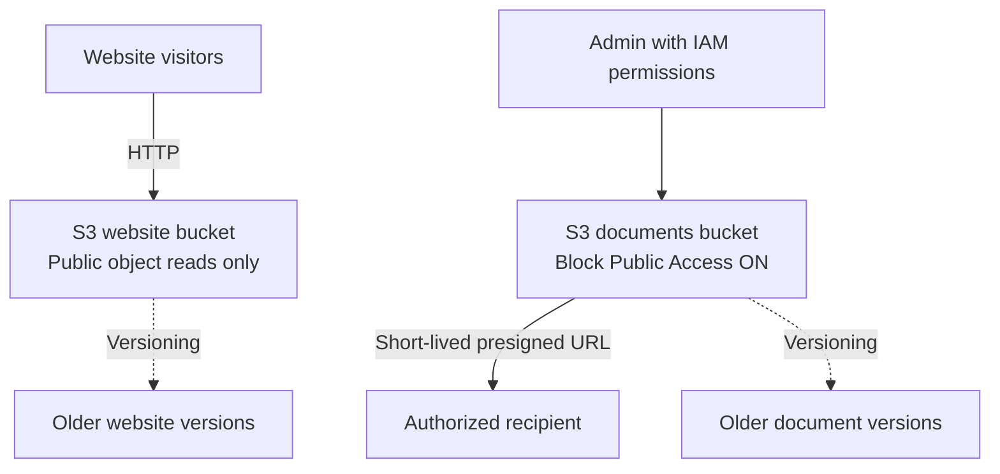

# AWS S3 Static Website & Secure File Storage

A portfolio project for hosting a public static college website in Amazon S3 while keeping downloadable documents private and sharing them through short-lived presigned URLs.

## Scenario
Greenfield College needs a public information site, private document storage, temporary download links, and a way to recover older files after accidental overwrites.

## Architecture


**Important:** The S3 static website endpoint is HTTP-only. For production HTTPS, consider CloudFront with an appropriately secured S3 origin. Never make the documents bucket public.

## Folder structure
```text
aws-s3-static-website-file-storage/
├── README.md
├── .gitignore
├── LICENSE
├── website/
│   ├── index.html
│   ├── css/styles.css
│   └── js/main.js
├── policies/
│   ├── website-public-read-policy.template.json
│   └── documents-private-access-notes.md
├── scripts/
│   ├── verify-aws-identity.ps1
│   ├── upload-website.ps1
│   └── generate-presigned-url.ps1
├── docs/
│   ├── architecture.md
│   ├── deployment-guide.md
│   ├── testing-and-troubleshooting.md
│   ├── security-checklist.md
│   └── interview-questions.md
└── screenshots/README.md
```

## AWS resources
- S3 website bucket: public website objects only.
- S3 documents bucket: private files; keep all Block Public Access settings enabled.
- Versioning enabled on both buckets.
- Bucket policy grants only `s3:GetObject` on the website bucket.
- Presigned URL grants time-limited access to an individual object.

## Deploy (Mumbai region)
1. Create two globally unique buckets in `ap-south-1`: `college-website-YOUR-SUFFIX` and `college-documents-YOUR-SUFFIX`.
2. Enable versioning on both.
3. Upload the contents of `website/` to the website bucket.
4. Enable Static website hosting; set index document to `index.html`.
5. Apply `policies/website-public-read-policy.template.json` to the website bucket only, replacing the placeholder bucket name. Adjust Block Public Access only for the website bucket if required by the policy. Do not change the private documents bucket.
6. Upload a harmless sample PDF to the private documents bucket.
7. Generate a short-lived URL and test it before and after expiry.
8. Upload a modified object with the same key, inspect versions, and restore an older version.

Detailed instructions: [`docs/deployment-guide.md`](docs/deployment-guide.md).

## AWS CLI (PowerShell)
Verify your identity before making changes:
```powershell
aws --version
aws sts get-caller-identity
aws configure get region
```
Upload website assets:
```powershell
aws s3 sync .\website\ s3://YOUR-WEBSITE-BUCKET/ --region ap-south-1
```
Generate a five-minute presigned URL:
```powershell
aws s3 presign s3://YOUR-DOCUMENTS-BUCKET/college-brochure.pdf --expires-in 300 --region ap-south-1
```
Only run commands after replacing placeholders. A presigned URL is a bearer link: anyone who obtains it may use it until it expires, subject to permissions. Never commit it or publish it in screenshots.

## Security
| Resource | Access | Protection |
|---|---|---|
| Website bucket | Public read of website objects | Only `s3:GetObject`; no public writes/deletes |
| Documents bucket | Private | Block Public Access enabled; no public policy |
| Presigned URL | Temporary access to one object | Short expiry; share privately |
| AWS identity | Authorized administration | Least privilege; no credentials in Git |

## Validation checklist
- [ ] Homepage opens using the S3 website endpoint.
- [ ] CSS and JavaScript load.
- [ ] Anonymous website reads work; anonymous writes do not.
- [ ] Private documents are not anonymously accessible.
- [ ] Presigned URL works before expiry and fails after expiry.
- [ ] Versioning is enabled and an older version can be restored.
- [ ] Screenshots are added without secrets or live URLs.
- [ ] Both buckets are emptied (including all versions/delete markers) and deleted after the lab if no longer needed.

## Cleanup and cost
S3 storage, requests, and data transfer may incur charges. Remove the website policy and disable hosting, delete all object versions and delete markers, delete both buckets, remove temporary permissions, and check AWS Billing.

## Learning outcomes
S3 object storage, static website hosting, bucket policies, Block Public Access, versioning, presigned URLs, IAM permissions, and troubleshooting.

See `docs/interview-questions.md` for interview practice.
